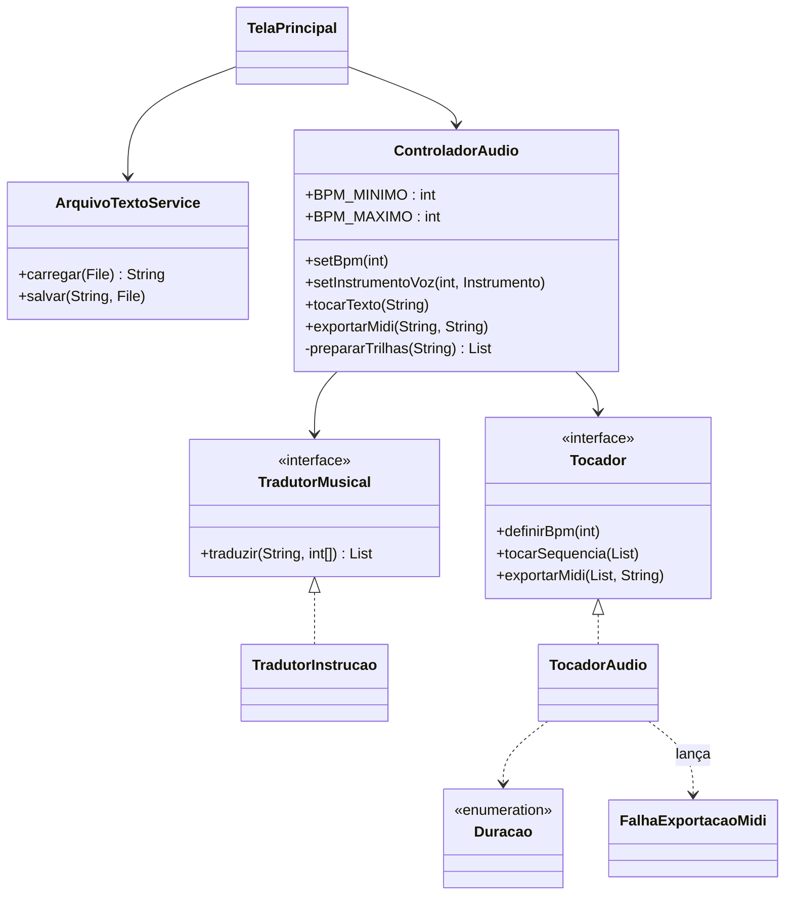
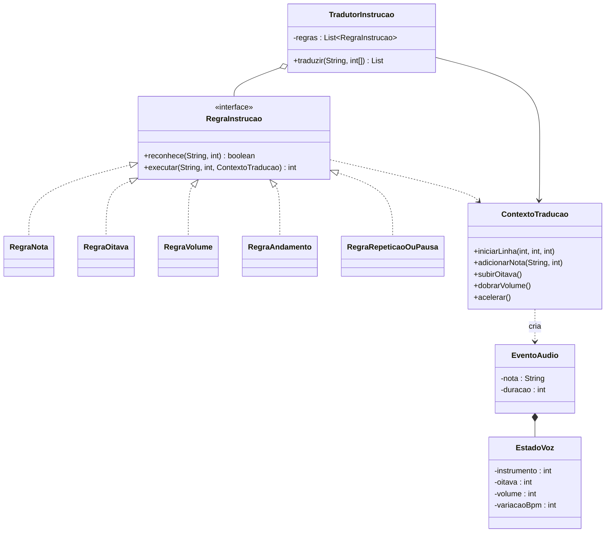

# PROJECT-INFO1120-DEV-SW AKA Pepper Music Player

Gerador de sequências musicais a partir de texto INF01120 

## Requisitos

| Ferramenta | Versão | Como conferir |
|---|---|---|
| JDK (Java Development Kit) | 21 (a mesma do `pom.xml`) | `java -version` |
| Apache Maven | 3.8 ou superior | `mvn -v` |

### Instalando o Maven no Windows

1. Baixe o ZIP "Binary" em <https://maven.apache.org/download.cgi> e extraia, por exemplo, em `C:\Tools\apache-maven-3.9.x`.
2. Crie a variável de ambiente `JAVA_HOME` apontando para a pasta do JDK.
3. Adicione `C:\Tools\apache-maven-3.9.x\bin` ao `Path`.
4. Abra um **novo** terminal e confira com `mvn -v`.

## Como rodar

Na pasta do projeto (onde está o `pom.xml`):

```bash
mvn clean package
java -jar target/pepper_music_player-1.0-SNAPSHOT.jar
```

- `mvn clean package` apaga o `target/`, compila e gera um JAR único (*fat JAR*, via `maven-shade-plugin`) que já inclui o JFugue.
- Você precisa repetir o `mvn clean package` sempre que alterar o código. Para só checar se compila: `mvn compile`.
- O JAR gerado roda em qualquer máquina com Java instalado, sem Maven.

### Pelo VSCode

1. Instale o **Extension Pack for Java** (inclui *Maven for Java*).
2. Abra a pasta do projeto (a que contém o `pom.xml`).
3. Execute a classe `pepper.Main` pelo botão **Run** acima do método `main`, ou use o painel *Maven* → `Lifecycle` → `package`.

## Testes

```bash
mvn test
```

- `CaracterizacaoTest` ("golden master"): guarda o padrão musical gerado para várias entradas (incluindo `docs/example1_fase2.txt`) em `src/test/resources/esperado/`. Serve para provar que uma refatoração não mudou o som. **Não edite esses arquivos** para fazer um teste passar: se ele quebrou, o erro está na mudança.
- `TradutorInstrucaoTest`: regras do enunciado (notas, acidentes, duração, oitava, delay, repetição, quebra de linha do Windows).
- `ControladorAudioTest`: validações (BPM, instrumento, texto em branco) usando um tradutor e um tocador falsos, sem tocar áudio.
- `TocadorAudioTest`: exportar para uma pasta inexistente lança `FalhaExportacaoMidi`.

## Estrutura do projeto

```
src/main/java/pepper/
    Main.java                    ponto de entrada; abre a TelaPrincipal
    TelaPrincipal.java           interface gráfica (Swing)
    ArquivoTextoService.java     ler e salvar arquivos .txt
    ControladorAudio.java        coordena o fluxo; valida BPM e instrumentos
    TradutorMusical.java         interface: texto -> eventos
    TradutorInstrucao.java       implementa o tradutor, percorrendo uma lista de regras
    RegraInstrucao.java          interface de uma regra de interpretação
    RegraNota / RegraOitava / RegraVolume / RegraAndamento / RegraRepeticaoOuPausa
    ContextoTraducao.java        estado de leitura de uma linha (voz)
    EventoAudio.java             nota pronta para tocar (imutável)
    EstadoVoz.java               instrumento, oitava, volume e variação de BPM (imutável)
    Duracao.java                 enum das durações 1 a 7 (letra do JFugue e beats)
    Tocador.java                 interface: tocar e exportar
    TocadorAudio.java            única classe que conhece o JFugue
    FalhaExportacaoMidi.java     erro ao gravar o arquivo MIDI
    Instrumento.java             catálogo número MIDI -> nome
src/test/java/pepper/            testes (JUnit 5)
docs/example1_fase2.txt          exemplo de música
```

## Arquitetura

Camadas do programa:



Como o texto vira eventos (dentro do `TradutorInstrucao`):



Fluxo principal:

```
TelaPrincipal -> ControladorAudio -> TradutorMusical -> List<List<EventoAudio>> -> Tocador -> JFugue
```

Cada camada conversa com a de baixo por uma **interface** (`TradutorMusical`, `Tocador`): a tela não conhece o tradutor nem o som, o tradutor não conhece o som e o tocador não conhece a interface.

**Como acrescentar uma instrução nova:** crie uma classe que implemente `RegraInstrucao` e registre-a em `TradutorInstrucao.criarRegras()`, antes da `RegraRepeticaoOuPausa` (que reconhece qualquer caractere e deve ser a última). Nenhuma outra classe precisa mudar.

## Refatorações da Fase 3 (revisão do Grupo 5)

| Observação | O que foi feito |
|---|---|
| Código duplicado | `ControladorAudio.prepararTrilhas` |
| Classe grande | leitura/gravação de TXT saiu para `ArquivoTextoService` |
| Método longo | `TelaPrincipal.inicializarComponentes` dividido em métodos `criar...` |
| Lista de parâmetros longa | `EventoAudio(nota, duracao, EstadoVoz)` no lugar de 6 parâmetros |
| Obsessão por primitivos | `enum Duracao` (a lógica de duração estava duplicada no `TocadorAudio`) |
| Switch/if-else longo | uma classe por regra (`RegraInstrucao`) + `ContextoTraducao` |
| Validação de regras de domínio | `setBpm` e `setInstrumentoVoz` validam os valores |
| Inversão de dependência | interfaces `TradutorMusical` e `Tocador`, injeção pelo construtor |
| Exceções | `FalhaExportacaoMidi`; a tela trata `IOException` e `FalhaExportacaoMidi` separadamente |
| Entradas textuais | texto em branco é recusado com aviso na tela |

## Dependências (resolvidas pelo Maven)

- **JFugue 5.0.9** (`jfugue:jfugue`). Não está no Maven Central; está publicada no repositório Maven do **SING Group**, por isso o `pom.xml` declara o repositório `https://maven.sing-group.org/repository/maven/`.

## Uso de IA

Durante o desenvolvimento, o grupo usou assistentes de IA para:

- **Convenções:** discussão de convenções de código Java e Maven (tipos, pacotes, estrutura do projeto).
- **Configuração:** geração e ajustes do `pom.xml`.
- **Documentação:** redação de partes deste README.
- **Testes:** criação de músicas de exemplo.
